# Interface redesign (issue #80): before and after

Same screens, same synthetic data (mock mode, signed in as `lead@example.test`), taken with Playwright Chromium on 2026-11-12. "Before" is commit `f4fcf86`; "after" is the redesign. Desktop is 1280×800 and phone is 390×844. What changed and why is in [../design.md](../design.md); page timings are in [../performance-evidence.md](../performance-evidence.md#interface-redesign-issue-80).

## Project list view, desktop

The filters wrapped into five rows under the search box. Now the view switcher sits on its own row, and search plus every filter fits on one row. The quick-add hint is a quiet line instead of a row of key caps.

| Before | After |
| --- | --- |
| 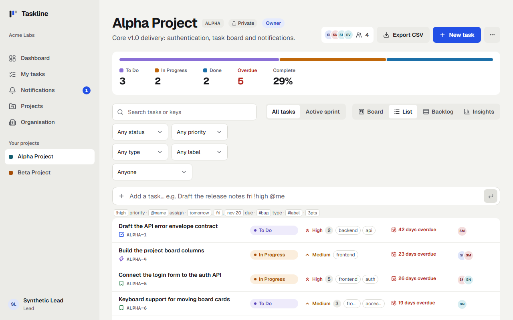 | 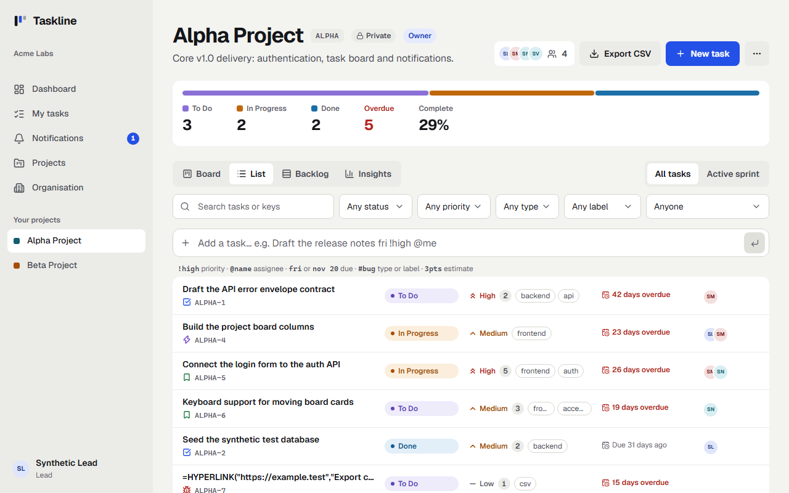 |

## Project board, phone

The selects were squeezed to "An…" and the view switcher ran off the screen. Now the switcher fits the width, and the selects keep their full labels and scroll sideways.

| Before | After |
| --- | --- |
| 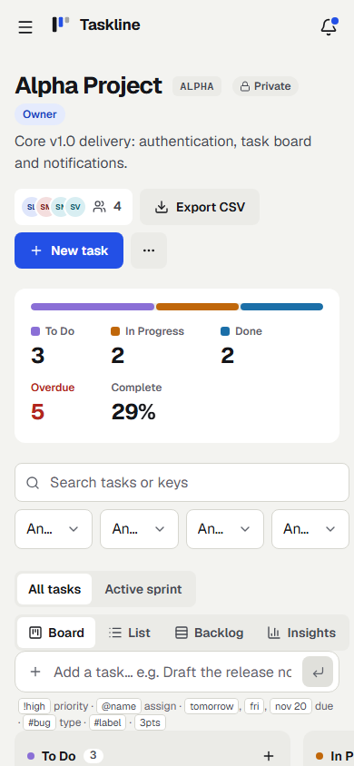 | 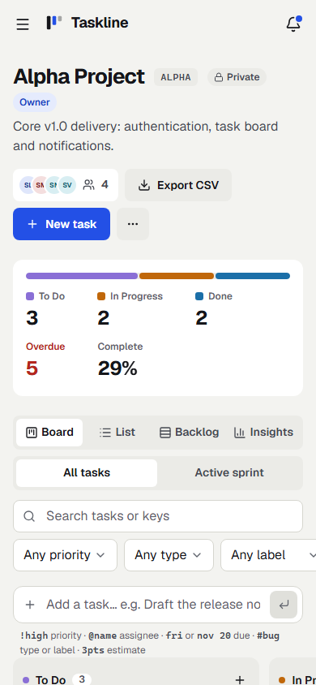 |

## Task sheet, phone

An epic's item list pushed the sheet wider than the screen ("0/1 don…", the status cut off). Now long titles truncate and the progress text shows in full.

| Before | After |
| --- | --- |
| 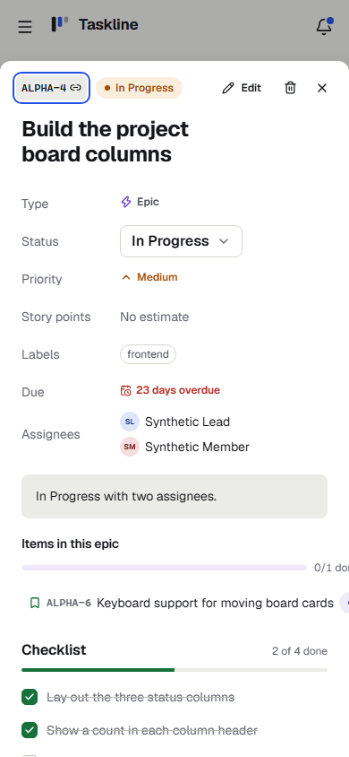 | 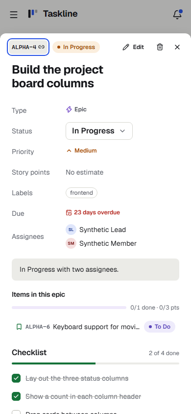 |

## Insights, dark theme

The Sprint report's icon sat on its own line above the title. Now it matches Delivery forecast.

| Before | After |
| --- | --- |
| 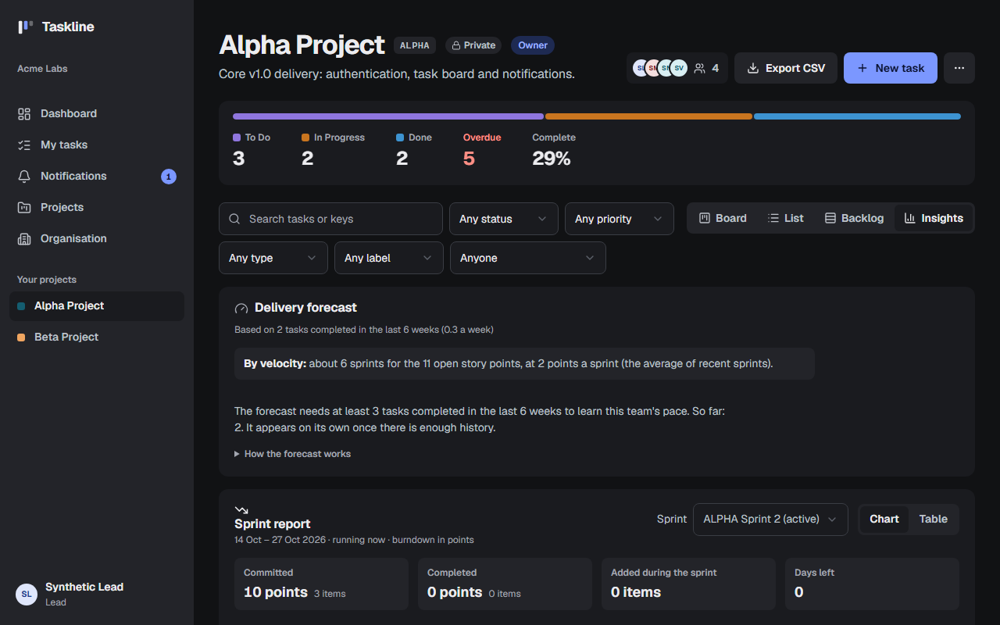 | 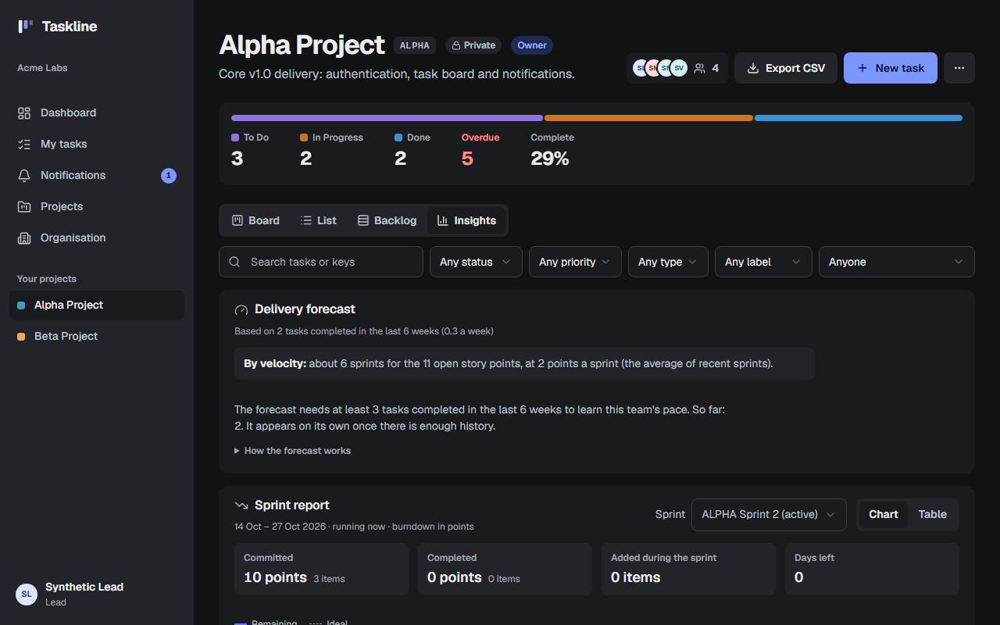 |

## My tasks, desktop

The filters wrapped onto a second row, with the task count floating in the middle. Now it's the same two-row toolbar as the project views, with the count at the end of the filter row.

| Before | After |
| --- | --- |
| 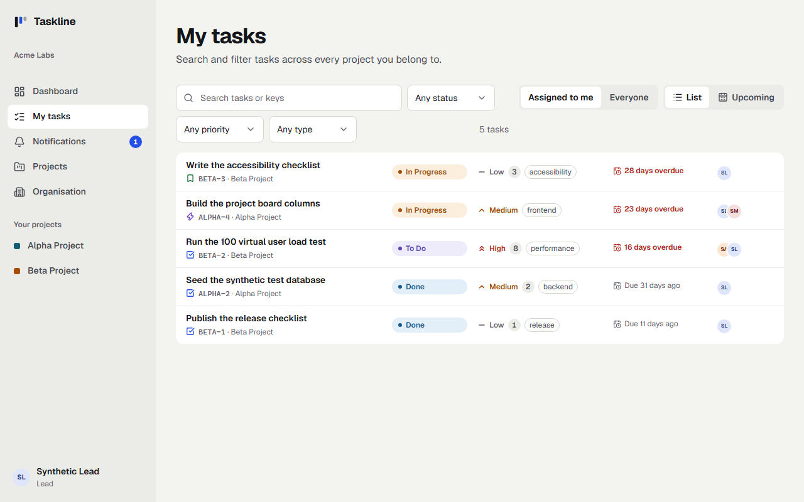 | 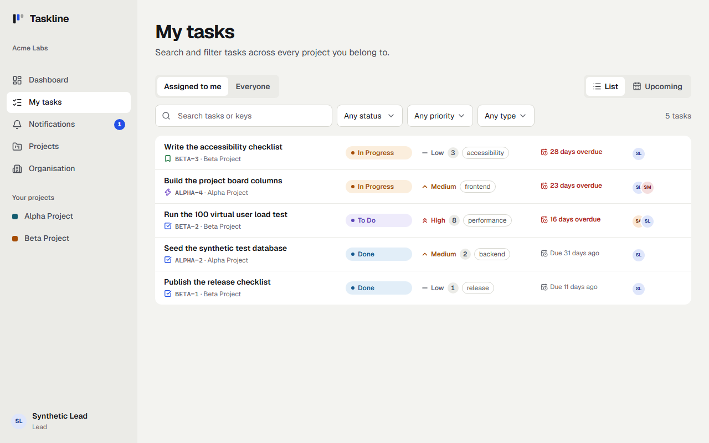 |

## Project board, dark theme

| Before | After |
| --- | --- |
| 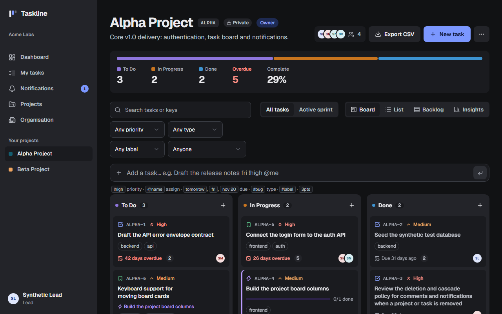 | 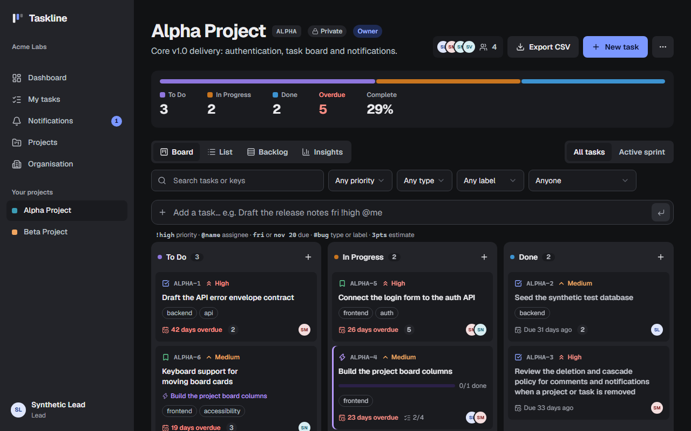 |
